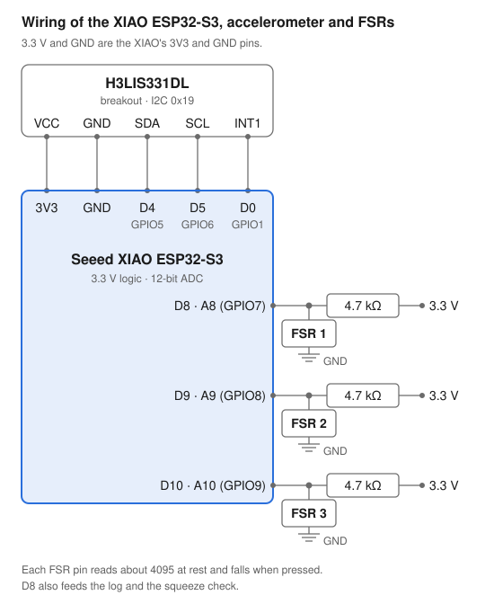
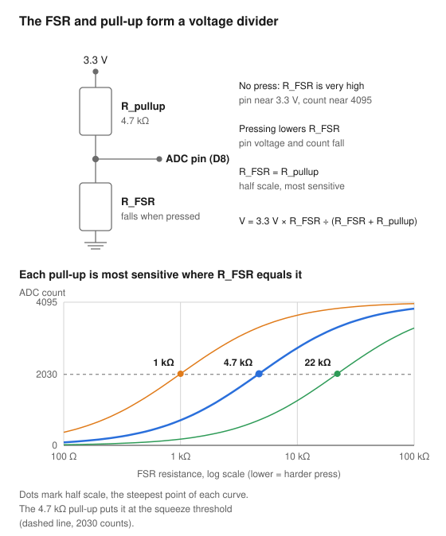
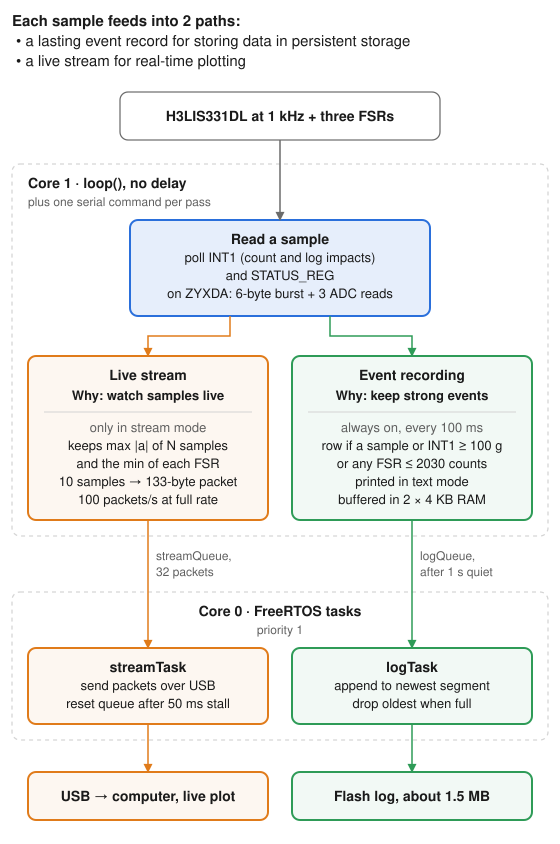

# Kidney Guard Firmware — Implementation Spec

Nov 6, 2026

## 1. Purpose and Scope

The Kidney Guard firmware samples a ±200 g accelerometer at 1 kHz and reads three force-sensitive resistors (FSRs) with every accelerometer sample. It logs impacts and hard squeezes to on-board flash, and can stream every raw sample to a host computer over USB.

The firmware provides:

- 1 kHz three-axis acceleration from an H3LIS331DL over 400 kHz I2C
- Impact counting from the accelerometer's latched threshold interrupt (INT1)
- Three FSR readings on the ESP32-S3's 12-bit ADC, taken with each accelerometer sample
- A CSV event row for each 100 ms window that crosses an impact or squeeze threshold, printed and kept in a ring log on flash
- A binary stream of every sample, optionally decimated, for a host program
- A USB serial interface for text output, log access and stream control

This spec covers the firmware running on the ESP32-S3 and the wiring it expects. Host-side software that reads the stream or the log is out of scope.

## 2. ESP32-S3 Overview

The processor is a Seeed Studio XIAO ESP32-S3. It powers both sensors from its 3V3 pin, talks to the accelerometer over I2C, and reads the FSRs on three ADC pins.



**ESP32-S3 resources the firmware uses**

| Resource | Use |
| --- | --- |
| Core 1 | Arduino `loop()`: polls the sensors, builds event rows and stream packets |
| Core 0 | FreeRTOS tasks for flash writes (`logTask`) and USB writes (`streamTask`) |
| I2C (`Wire`), 400 kHz | Accelerometer on D4 (SDA) and D5 (SCL) |
| GPIO input | Accelerometer INT1 on D0 |
| ADC, 12-bit (0–4095) | FSR 1–3 on D8, D9, D10 |
| Native USB CDC, 115200 baud | Text output, log dump, binary stream, commands |
| Flash, LittleFS | Event log on the default "spiffs" partition, about 1.5 MB |
| NVS (`Preferences`) | Boot counter, namespace `kidney_guard`, key `boot` |

**Pin map**

| XIAO pin | ESP32-S3 GPIO | Signal | Direction |
| --- | --- | --- | --- |
| 3V3 | — | 3.3 V supply to the accelerometer and the FSR dividers | Out |
| GND | — | Ground for the accelerometer and the FSRs | — |
| D0 | GPIO1 | Accelerometer INT1 | In |
| D4 | GPIO5 | I2C SDA | In/out |
| D5 | GPIO6 | I2C SCL | Out |
| D8 / A8 | GPIO7 | FSR 1 divider | Analog in |
| D9 / A9 | GPIO8 | FSR 2 divider | Analog in |
| D10 / A10 | GPIO9 | FSR 3 divider | Analog in |

All logic is 3.3 V. No pins other than these are used.

## 3. FSR Wiring and Configuration

Each FSR is the low side of a voltage divider with a 4.7 kΩ pull-up to 3.3 V. Its ADC pin reads about 4095 at rest and falls as the FSR is pressed, so the lowest reading is the hardest press.

**Wiring**

| FSR | XIAO pin | GPIO | Top of divider | Bottom of divider |
| --- | --- | --- | --- | --- |
| FSR 1 | D8 / A8 | GPIO7 | 4.7 kΩ to 3V3 | FSR to GND |
| FSR 2 | D9 / A9 | GPIO8 | 4.7 kΩ to 3V3 | FSR to GND |
| FSR 3 | D10 / A10 | GPIO9 | 4.7 kΩ to 3V3 | FSR to GND |

The pin voltage is V = 3.3 V × R\_FSR ÷ (R\_FSR + 4.7 kΩ). With no pressure the FSR is near open circuit, so the pin sits near 3.3 V (count 4095). At R\_FSR = 4.7 kΩ it reads half scale.

**Configuration**

- `FSR_PINS = {A8, A9, A10}`, each set as `INPUT` in `setup()`. No internal pull-up or pull-down is used.
- `analogRead()` returns 0–4095 with the default ADC settings (`FSR_ADC_MAX` = 4095).
- All three FSRs are read right after each accelerometer sample, so they are sampled at 1 kHz.
- Voltage for the log: `fsr_v` = count × 3.3 ÷ 4095.

**How each FSR is used**

| FSR | Event log | Squeeze check | Stream |
| --- | --- | --- | --- |
| FSR 1 (D8) | Lowest reading of each 100 ms window | Row made at ≤ 2030 counts (`FSR_HEAVY_ADC`, "Heavy Squeeze") | Yes |
| FSR 2 (D9) | — | — | Yes |
| FSR 3 (D10) | — | — | Yes |

In the stream, each FSR sends its lowest reading of every decimation group, so a short press survives decimation. 2030 counts is about 1.64 V, an FSR resistance of about 4.6 kΩ.

### Choosing the pull-up resistor

The best pull-up equals the FSR's resistance at the force of most interest. The current 4.7 kΩ already places the most sensitive point at the squeeze threshold (2030 counts, R\_FSR ≈ 4.6 kΩ).



**How it works.** The pull-up and the FSR divide 3.3 V, and the ADC reads the voltage between them:

```latex
V = 3.3\,\text{V} \times \frac{R_{FSR}}{R_{FSR} + R_{pullup}}
```

An FSR's resistance falls roughly in proportion to the applied force. The change in voltage for a given relative change in force is therefore largest where R\_FSR = R\_pullup. At that point the pin sits at half scale (1.65 V, about 2048 counts). Far from it, on either side, the curve flattens and large force changes produce only small changes in counts.

**Covering a range of forces.** Choose the geometric mean of the FSR resistance at the lightest and hardest press of interest:

```latex
R_{pullup} = \sqrt{R_{light} \times R_{hard}}
```

For example, 30 kΩ at a light press and 300 Ω at the hardest press gives √(30 kΩ × 300 Ω) ≈ 3 kΩ. That spreads the range evenly across the ADC.

| Force of most interest | Pull-up |
| --- | --- |
| Light touches | 10–22 kΩ |
| Moderate squeezes (current threshold) | 4.7 kΩ |
| Very hard presses | 1–2.2 kΩ |

**Practical limits on the ESP32-S3**

- **High values (above about 20 kΩ):** the ADC's sample-and-hold sees a high source impedance, and the firmware reads three channels back to back. Readings get noisier and can carry over between channels. If a high value is used, add 10–100 nF from each ADC pin to ground.
- **Low values (below about 1 kΩ):** current rises, up to 3.3 mA per FSR under a hard press at 1 kΩ. Low FSR resistances also push readings into the bottom of the ADC range.
- **ADC ends:** the ESP32-S3 ADC is least accurate near 0 and 4095. Aim for the forces of interest to read roughly 300–3700 counts.

**Measuring the FSR.** With the existing 4.7 kΩ pull-up, stream the FSRs, press at the lightest and hardest levels of interest, and convert each reading:

```latex
R_{FSR} = 4.7\,\text{k}\Omega \times \frac{count}{4095 - count}
```

Then apply the geometric-mean formula above.

## 4. Accelerometer Wiring and Configuration

The H3LIS331DL runs at ±200 g and 1000 Hz on I2C address 0x19, with Block Data Update on. INT1 is latched high when any axis exceeds 50 g.

**Wiring**

| H3LIS331DL pin | XIAO pin | GPIO | Notes |
| --- | --- | --- | --- |
| VCC | 3V3 | — | 3.3 V supply |
| GND | GND | — |  |
| SDA | D4 | GPIO5 | I2C data, 400 kHz |
| SCL | D5 | GPIO6 | I2C clock |
| INT1 | D0 | GPIO1 | Active high, latched until `INT1_SRC` is read |

## 5. Serial Interface

The firmware talks to the host over the ESP32-S3's native USB CDC port at 115200 baud. It runs in one of two modes: text (the default after boot) or binary stream. The flash log keeps running in both.

## 6. Firmware Architecture

All sampling happens in `loop()` on core 1. The two slow writers, flash and USB, run as FreeRTOS tasks on core 0 and are fed through queues, so a write never holds up a sample.

Every sample feeds two independent paths:

- **Live stream** (orange): sends the samples to a computer so they can be watched and plotted as they happen. It runs only in stream mode and keeps nothing.
- **Event recording** (green): always runs, and keeps a lasting record on flash of each 100 ms window with a strong impact or hard squeeze.


